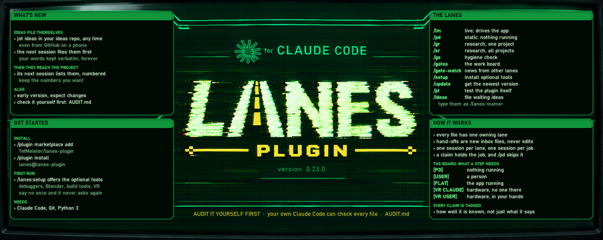

# lanes



**A growing collection of tools, skills and programs for Claude Code, primarily meant for flat-to-VR video game modding.**

**A shared board.** One list of every job, each tagged with what it needs. It answers the question
you have at the start of every session: *what can I actually do right now?*

## The lanes

| Command | Name | What it does |
| --- | --- | --- |
| `/lm` | Live Modding | Claude runs the app itself: starts it, uses it, closes it, and tests its own changes. |
| `/pd` | Parallel Development | Picks the next job that needs nothing running, so it can work beside anything else. |
| `/ms` | Manual Session | You do the hands-on work; Claude gives you the steps and writes the code. |
| `/gr` | Guided Research | Web research for each project, kept in that project's notes. |
| `/sr` | Sweep Research | Research across all projects, kept in one shared library. |
| `/gs` | Good-standing Sweep | Hygiene check: are notes tagged, and are hand-offs being picked up? |
| `/gu` | GitHub Update | The weekly tool check: brings your tools up to date both ways, flags new releases of outside tools, feeds lessons into the tools, and keeps your repo descriptions and front pages up to date. |
| `/gd` | Gold Digger | Reads the logs and reports every run leaves behind, shelf by shelf (camera, guns, jitter, menus...), and hands the few new facts to the notes. Every run's logs are kept on those shelves by themselves. |
| `/ch` | Code health | Re-reads your own tools with the Inspector on and tidies only what cannot change how they work, after saving a working copy of everything to GitHub and a backup folder. |
| `/fullscan` | Full Scan | The weekly check-up in one go: Gold Digger, research, the tool check, code health and the tidiness pass, then everything saved, with install questions left to the end. |
| `/gates` | Gate Board | Shows the work board. |
| `/gate-watch` | Gate Watch | Tells you when another session finishes something. |
| `/ideas` | Ideas | Files the ideas you jotted down, onto the right project. |
| `/bench` | VR Bench | A robot player for VR games: with the pretend headset, it moves the head, both hands and every button by itself and writes down what the game did, so VR work can be tested with nobody in the headset. |
| `/menu` | Menu-o-matiC, Move-o-matiC and State-o-matiC | You play a game's menus and a short route once while it records; after that it repeats them by itself, and can tell menu, loading, cutscene and gameplay apart. |
| `/setup` | Setup | First-run setup: your name, this PC's name, and optional tools. |
| `/update` | Update | Gets the newest version of the plugin, after asking you. |
| `/uninstall` | Uninstall | Takes Lanes off this PC in one go, after showing what it will do: the look, the shortcut, its helpers and settings, then the plugin. Your own work stays. |
| `/theme` | Theme | The plugin's look (see below): puts it on, or puts your terminal back the way it was. |
| `/pt` | Plugin Test | Tests the plugin itself. |

Type them as `/lanes:<name>`, for example `/lanes:pd`.

**Prefer other names?** Just ask Claude Code, for example: *"make /research run /lanes:gr"*. Any
command can be given a name you like, except `/pd` and `/lm`: their safety checks look for those
two names, so keep them as they are.

## How it works

- **One session per lane, one session per job.** A session claims its job, and the others skip it.
- **`/lm` and `/pd` never work on the same project at once.** While `/lm` holds a project, `/pd` is
  stopped from starting on it and picks another. Two sessions on one project was tried and worked
  once in fifty runs, so it was removed. Instead, `/lm` runs its own helper in the background for
  the no-app-needed work on that project.
- **The board says what each step needs:**

  | Tag | Needs |
  | --- | --- |
  | `[PD]` | nothing running |
  | `[USER]` | a person |
  | `[FLAT]` | the app running |
  | `[VR CLAUDE]` | special hardware plugged in, nobody needed |
  | `[VR USER]` | a person using the special hardware |

- **Every finding says how well it is known,** not just what it says.
- **It tells you which model a job needs.** Before starting, a session says whether the job wants
  the strongest model, the standard one or a light one, and whether the one running fits. Too weak:
  it stops and waits for you to switch. Stronger than needed: it says so and carries on. It also
  names the model for the next step, so you can switch before it starts. Getting it working comes
  first; saving tokens second.
- **Two PCs?** A job only one PC can do is queued for that PC, and greets it at its next session.
- **Nobody's name is written down.** You are "User" unless you choose a name. Each PC is PC1, PC2
  and so on unless you name it. Your real name, login and computer name are never written.
- **Ideas get filed for you.** Jot them into your ideas repo, even from a phone. The next session
  files them, and each project's next session lists them for you to pick from.

## Everything Lanes gives you: a guide for someone starting out

Lanes was built while turning flat-screen games into VR, by one person who is not a programmer and an
AI that writes the code. Everything below came from a real problem met along the way. You do not have
to learn any of it up front: the sessions follow it for you, and you can switch most of it off.

### Replies you can actually read

- **Short, plain answers.** Sessions are told to write for a person who loves games, not for a
  programmer: what changed for you, in everyday words, with the technical detail saved in the
  project's notes instead of the reply.
- **Fixed icons on every heading,** so you can jump straight to the part that wants something from
  you: 🔧 what I did · 🎯 what it means for you · ⚠️ worth knowing · ❓ what I need from you (always
  last, so it sits right above where you type) · 🎬 what was recorded · 🎮 in front of each project
  when a reply covers several · ✅ "you can stop" the moment a held test has what it needed.
- **A one-line answer stays one line.** A yes, a no or a quick fact gets no headings at all.

### It tells you what the next step needs, and which model to use

- **The gate box.** Every session ends by saying, in capitals, what the next step requires: nothing
  running (`PD`), the game running (`FLAT`), the headset plugged in (`VR CLAUDE`) or you in the headset
  (`VR USER`). You can decide at a glance whether to put the headset on tonight.
- **The model box.** Each next job is named with the model it suits: the strongest for hard,
  never-solved problems, the standard one for normal work, a light one for tidying. At the start of a
  session it checks the model you are running: too weak, it stops and says what to switch to; stronger
  than needed, it says so and carries on.

### Nothing gets lost

- **The close-out box.** Every session ends with a table that checks every one of your repos and says
  **SAVED** (everything is on GitHub) or **NOT SAVED** (and which repo). No green box, no trust: type
  `/sp` and it saves properly. A line under it says whether anything this session started is still
  running, so you know if Claude Code can be closed.
- **Every session summary is kept,** dated, in its own folder per project, and pushed to a private repo
  if you have one. When a problem keeps coming back, sessions search the old summaries first.
- **A weekly tool check, `/lanes:gu` (new in 0.67.0).** Brings everything you rely on up to date: newer
  versions of your own tools come down or go up, two copies of a tool are put back in step, outside tools with
  a new release are listed with what is new (installed only on your yes), and lessons noted while driving games
  go into the tools. Since 0.69.0 it also checks your public repos' descriptions and front pages, and rewrites
  the ones that fell behind the work (an old version number, "nothing released" beside a release). A line at
  session start says when a week has passed.
- **Sessions get better at driving each game (0.66.0).** Each game keeps a note beside its recorded
  menu routes of what sessions have learned (menu buttons, controls, hazards). It is read before every launch
  and added to as soon as something new turns up, so no session has to rediscover a game's menus.
- **Your PCs know what the other has (0.65.0).** Each PC keeps a small note of which of our apps
  it has, and every session start says when another PC has one this PC does not. When you say a job is
  done on the other PC, the session that hears it clears that PC's reminder, quoting you.
- **Look inside the running game, and choose the extras (new in 0.82.0).** Setup now offers praydog's RE Engine MCP
  and elliotttate's UEVR-MCP: with them, Claude can read and change a running Resident Evil or Unreal Engine game's
  own objects and values live instead of guessing from memory, and the game half goes in only from that game's own
  session. A new install also chooses six built-in extras at setup (the green look, the BeG0nE recorders, screen
  effects off in VR and three more) instead of getting them all; a PC updating keeps them as they were. And the
  activity page now gets a line only when work actually moved forward.
- **Unlock everything before modding a game (0.81.0).** Offered once: sessions look for a developer mode,
  cheat, setting or file that gives every weapon and item from the start, find it in the game's files with no game
  running, and build it into the launcher on the first run, so nobody has to play through a game before modding it.
- **Every tool says what it is for and who made it (0.80.0).** Setup's tool list names the maker of
  each tool with a link, describes it in plain words, and now also offers Steamless, CubeKit, GIMP with its
  Claude link, Real-ESRGAN and the OBS recording tools. It asks only about what fits your work, and a new
  section describes everything Lanes does by itself.
- **A whole GitHub setup, step by step (0.78.0).** A guide takes you from no GitHub account to the
  full working setup, and Claude builds the rest: the private work board, ideas, hand-over, build and
  session-log repos, a copy for each kind of session, and a repo per project with its folders and inboxes.
  It shows the plan first, never overwrites anything, and makes nothing public without asking.
- **Offers are made once, and thanks on GitHub (0.75.0).** Everything Lanes offers to add is asked once, at the
  first setup or on the update that brings it, and never again whatever the answer. One new offer: sessions can
  star and follow, on your GitHub, the people whose tools, mods or findings your work uses.
- **Conversations stay short, and nothing is lost (0.63.0).** Claude Code summarises a
  conversation by itself when it is nearly full. Lanes can make that happen earlier (40% full by
  default), which keeps each session sharper and cheaper. Just before every summary it saves a
  checkpoint for the project (what is not on GitHub yet, the job it holds, the next step, and your last
  requests word for word) and tells the summary what it must keep. Right after, the session writes
  anything still unrecorded onto the board first. The full conversation logs are copied to a folder on
  your PC, so Claude Code's 30-day clean-up never deletes them. If your Claude Code does not have the
  early-summary setting, the close-out box simply says **"SAVED - safe to /clear"** instead.
- **Every installed change is a numbered build** (optional): saved in a private repo, so you can go back
  to any version, on any PC.
- **Two PCs?** The handover light says when the other PC last saved and whether it ended cleanly, and a
  job only one PC can do is queued for that PC and greets it at its next session.

### Help with the modding itself

- **The BeG0nE recorders.** VR problems are hard to describe. Wired into your mod, the **jitter
  recorder** times every head pose and frame, so "it feels jittery" becomes a short report saying
  exactly where the stepping comes from. **Ghost Hand** finds where your real hand and the game's hand
  part (lag, offset, jumps, lost tracking, and gestures such as racking a slide that miss). The
  **occlusion drift** fix covers controllers that wander when the headset loses sight of them. After
  every headset session the PC turns each recording into a short report by itself, and the next session
  start shows one line per new report.
- **The Inspector** (optional). Every piece of code Claude writes is looked over. Anything messy (a
  file grown too long, a bare number that should have a name, a test left wired in) is written down as a
  note for you and Claude to decide on. It never edits code, saving always works, and only uploading
  waits until every note is answered.
- **Menu-o-matiC, Move-o-matiC and State-o-matiC.** You play a game's menus and a short route once while
  it records; after that it replays them by itself, and can tell a menu, a loading screen, a cutscene and
  gameplay apart, so automated tests cost no effort from you.
- **A first-file-into-the-game kit.** A small logging file is generated for a new game, to prove the
  game will load your code at all before any real work starts.
- **Rules learned the hard way, followed for you:** a new game is made to run in a 1280×720 window first
  (so you can still see the Claude Code window), and you are asked to confirm it once; every blur and
  screen effect (blood on the screen, the red low-health tint, shake, grain) is switched off in VR, so
  there is only gameplay; any VR mod someone else is already building is looked for before starting.
- **Game recording (optional).** Test runs can be recorded with OBS: only the game's own window and
  sound, never your desktop. Since 0.76.0 it can instead run only beside the jitter recorder, so every
  jitter report comes with its jittery seconds cut out of the recording frame by frame, each picture
  marked as standing still or jumping on screen. Offered once.
- **Ideas, from anywhere.** Jot an idea into your ideas repo, even from your phone's browser. The next
  session files it under the right game, and that game's next session lists it for you to pick from.

### Testing VR with nobody in the headset

- **A pretend headset (0.73.0).** `/lanes:setup` and the next `/lanes:update` offer the
  [OpenXR Simulator](https://github.com/elliotttate/OpenXR-Simulator) by elliotttate (or
  [webhead2oo9's fork](https://github.com/webhead2oo9/OpenXR-Simulator), which also runs 32-bit games): it shows a VR
  game's two eyes in a window on the desktop, so VR work can be checked with no headset plugged in. Downloading it
  never switches it on.
- **VR Bench, a robot player for VR games (0.74.0).** With the pretend headset as its eyes, our
  [VR Bench](https://github.com/TefMeister/vr-bench) plays both controllers by itself: it moves the head, the hands
  and every button in turn, takes a picture after each, and writes down what the game did, so a session can learn
  and test a VR game with nobody wearing anything (`/lanes:bench`). Since 0.77.0 it also moves the body like a
  player in a real room: a step forward, a step to the side, bending over and crouching. Setup offers it with
  webhead2oo9's simulator build. It is made with what we learned using elliotttate's OpenXR Simulator and tools.
- **Hand Freeze for VR (0.64.0).** `/lanes:setup` can install our small
  [Hand Freeze](https://github.com/TefMeister/hand-freeze-vr) app from GitHub: it holds both VR controllers
  still in any OpenXR game, so hand and weapon poses can be tuned with the mouse while the controllers lie
  on the desk. `/lanes:update` says when a newer Hand Freeze is out.

### Several sessions at once, safely

The lanes above (`/pd`, `/lm`, `/ms` and the research lanes) can run side by side. Each owns its own
files, claims its job on the board and skips a job another session holds. `/gates` shows every
project's open work grouped by what it needs, and `/gate-watch` tells you when another session finishes
something.

### Private by default

Nobody's name is written anywhere: you are "User", or the name you choose, and your PCs are PC1, PC2 and
so on. Every new GitHub repo a session makes is private, and you are asked before any is made public. A
privacy scan runs before every Lanes release.

## What `/lanes:setup` offers at first install

Nothing is installed without your yes, and one "no" means it never asks again. First it asks what to
call you and this PC, then a few yes/no questions (keep every build, switch on the Inspector, a synced
folder for files that must not go on GitHub, keep conversations short). Then it checks what is already
on your PC and offers the rest, one group at a time, either installing them for you or giving you the
official links:

| Group | What is offered |
| --- | --- |
| Core | Git (with Git Bash), the GitHub command-line tool, Python and its helper packages, uv, 7-Zip |
| Building mod code | llvm-mingw, CMake, Visual Studio Build Tools (C++), Rust, Lua |
| Reverse engineering | x64dbg with its Claude connection and ready-made workflows, Ghidrust (reads and decompiles a game's .exe without running it), RE Engine MCP and UEVR-MCP (look inside a running RE Engine or Unreal game) |
| Driving games unattended | a virtual gamepad driver (ViGEmBus) and its Python side |
| 3D | Blender and Blender MCP, so Claude can build models with you, live, in your Blender |
| VR | SteamVR, Virtual Desktop (for Quest headsets), the OpenXR Simulator (a pretend headset), VR Bench (a robot player) and Hand Freeze |
| Videos | DaVinci Resolve (free) to edit, FFmpeg so Claude can cut and convert recordings |

Per-game frameworks (REFramework, UEVR and similar) are only suggested when a game needs one.

## Make it yours

Almost everything can be changed. Settings live in one file, `~/.claude/lanes.conf` (the example in
[`lanes.conf.example`](plugins/lanes/lanes.conf.example) explains each one), and for anything else you
can simply ask Claude Code in your own words. Some examples:

- **Rename commands.** *"Make /research run /lanes:gr."* Any command can get a name you like, except
  `/pd` and `/lm`, whose safety checks look for those two names.
- **Swap the icons or the reply shape.** *"Use coloured circles instead of the section icons: ⚪ what I
  did, 🔵 what it means for me, 🟣 what you need from me, and number the rows."* Or ask for longer, more
  technical replies if that suits you.
- **Summarise earlier or later.** `early_summary = 30` summarises sooner; `early_summary = 60` later;
  `python tools/compact.py off` switches it off and the close-out box tells you when to `/clear`.
- **Keep the logs somewhere else.** `transcripts = <folder>` for the full conversation logs,
  `session_logs = <folder>` for the summaries.
- **Turn parts off.** `inspector = off`, `theme = off` (keep your own terminal look),
  `shortcut = off`. `/lanes:theme restore` puts your old look back.
- **Change the board's tags.** If you are not making VR mods, the five tags can stand for whatever your
  project needs: `[FLAT]` as "the app running", `[VR USER]` as "someone using the special hardware".
- **Name your PCs.** `machine_name = Desk` and `machine_name = Laptop` instead of PC1 and PC2.
- **Make new repos public by default** with `new_repos = public`, if you prefer to share as you go.

## Get started

```
/plugin marketplace add TefMeister/lanes-plugin
/plugin install lanes@lanes-plugin
```

Then run `/lanes:setup`. It asks what to call you and this PC, then offers the optional tools:
debuggers and decompilers, build tools, Blender and GIMP with their Claude links, VR helpers, and
recording tools. Each one comes with what it is for and who made it (the full list, with links, is
[`plugins/lanes/docs/TOOLS.md`](plugins/lanes/docs/TOOLS.md)). Say no once and it never asks again.

**The Inspector (optional, new in 0.37.0).** Switch it on and every piece of code Claude writes is
looked over: anything messy is noted for a decision before it is uploaded. It never edits code.
Setup asks; it stays off otherwise.

**The look (new in 0.41.0).** This is how the plugin ships: after you install it and restart Claude
Code, the first session puts an old green monitor on your terminal, with the Lanes banner in dim green behind
the text and a light that slowly runs down the screen.


The plugin comes with this one look. If Claude Code is running inside Windows Terminal, it goes on
the tab you are in. If not, it is added as a new tab type called **Green Monitor Claude**: open
Windows Terminal, click the small down arrow next to the + on the tab bar, and pick it. That tab
starts Claude Code on your Desktop. It backs the terminal's settings up first, and leaves a profile
alone if you already gave it a look of your own. Once the look is on, the next session offers (once) a shortcut named **Lanes** on your
Desktop that opens Claude Code in exactly this look; `/lanes:theme shortcut` makes one any time. `/lanes:theme restore` puts
everything back; `theme = off` in `lanes.conf` stops it. It needs Windows Terminal. The style, its
tuning numbers and more styles live in [terminal-themes](https://github.com/TefMeister/terminal-themes).

**Needs:** Claude Code, Git, Python 3.

**Check it first.** Don't take our word that it is safe. [`AUDIT.md`](AUDIT.md) is a request you
paste into your own Claude Code, which then reviews every file before you install.

## Still growing

The way of working behind it has been in development since early August 2026. It became this
plugin on 2026-09-09 and has been in daily use on two PCs since then, with a new version most days
(the newest are the robot VR player and jitter reports cut frame by frame). It was built for turning
flat games into VR, so many examples and optional tools lean that way. The lanes themselves work for
any project. Expect changes: `/lanes:update` tells you what is new and never installs without asking. The full manual is in
[`plugins/lanes/README.md`](plugins/lanes/README.md).

| Plugin | What it does | State |
| --- | --- | --- |
| [`lanes`](plugins/lanes/) | Several Claude Code sessions at once, without them treading on each other. | `0.92.0`, public, in daily use |

## Modding games?

The author's games in progress, and the research behind them, are listed on the author's
[GitHub profile](https://github.com/TefMeister).

## Licence

MIT, see [LICENSE](LICENSE).

*Made for Claude Code; not made by, or affiliated with, Anthropic.*
